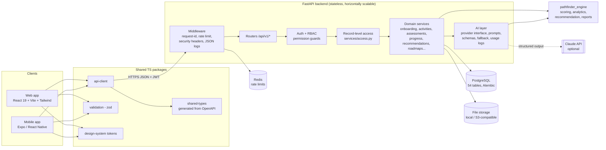
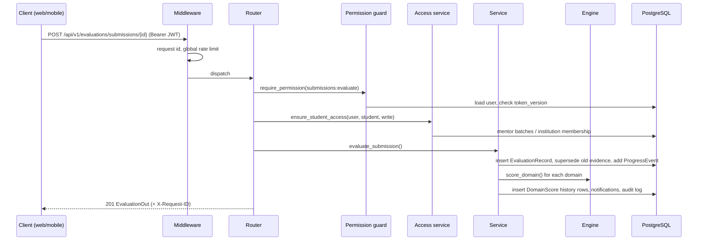
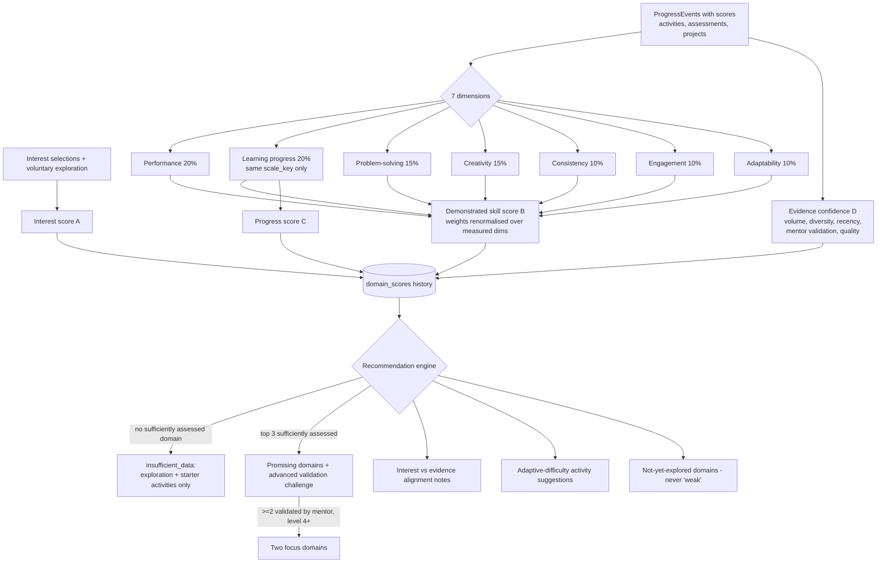
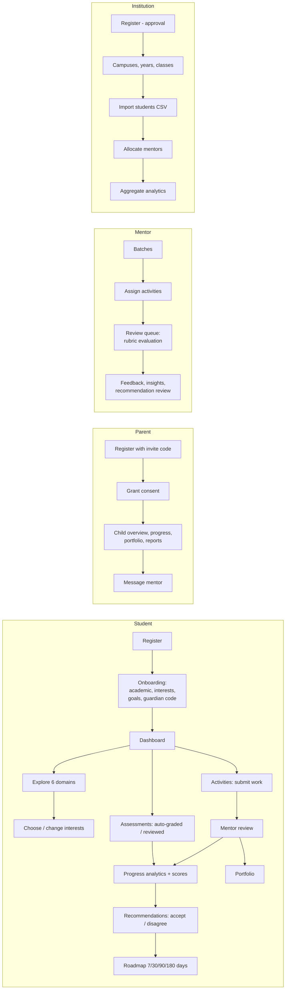

# PathFinder AI - System Architecture

## 1. System overview

**Key properties**

| Concern | Decision |
|---|---|
| Business logic | Lives only on the server (`backend/app/services`) and in the pure `ai-engine` package. Web and mobile share one typed API client, so no rule is implemented twice. |
| Authorisation | Permission-based RBAC (`core/permissions.py`) on every route **plus** record-level checks (`services/access.py`) for every student record. Nothing relies on the frontend. |
| Tenancy | Institution-scoped rows carry `institution_id`; `repositories/base.tenant_filter` and `access.accessible_student_ids` restrict every query. Cross-tenant reads return 404. |
| History | Scores, evaluations, progress events, interest changes and consent are append-only. Re-evaluation supersedes, never deletes. |
| AI | Provider-independent interface; Claude through the official SDK with structured outputs; deterministic record-grounded fallback for every feature; guardian consent required for minors. |
| Explainability | Every score lists its dimensions, weights, evidence count and confidence; every recommendation lists its reasons. |

## 2. Request lifecycle

## 3. Scoring and recommendation pipeline

Scoring weights are versioned in `scoring_configs`; each `domain_scores` row records the version used.

## 4. User flows

## 5. Architectural decision records

1. **Monorepo with npm workspaces** for web + shared packages; the Expo app is a sibling project that consumes the shared packages through Metro `extraNodeModules` (keeps React Native's pinned React version independent of the web app's).
2. **Pure scoring engine package** (`ai-engine/pathfinder_engine`) with no DB or framework imports - deterministic, unit-testable, reusable for reports and AI grounding.
3. **Append-only evidence stream** (`progress_events`) is the single source for scores and analytics; evaluations supersede rather than overwrite.
4. **Comparable-only improvement**: progress is measured within a `scale_key` (same assessment/activity). Improvement % returns `null` for zero/absent baselines.
5. **Tokens**: 15-minute JWT access tokens kept in memory; rotating opaque refresh tokens stored hashed. Web uses an httpOnly, SameSite=Strict, path-scoped cookie plus an `X-Requested-With` header (CSRF); mobile keeps the refresh token in the OS keychain (expo-secure-store). Refresh-token reuse revokes all sessions.
6. **SQLite fallback** for zero-setup local development and fast tests; PostgreSQL (JSONB) in Docker, CI and production. Alembic migrations are tested in CI and by `alembic check`.
7. **AI is optional and never authoritative**: structured outputs are validated, hallucinated IDs are stripped, failures fall back to the rule-based engine, and all output is labelled.
