# Database design

PostgreSQL 17 (JSONB columns) in production; SQLite for local fallback/tests. 54 tables, all with UUID primary keys,
foreign keys, timestamps and naming-convention constraints. Schema is owned by Alembic
(`backend/migrations`); `alembic check` in the test suite proves the models and migrations match.

## Conventions

| Convention | Implementation |
|---|---|
| Identifiers | UUID v4 (`Uuid` type) |
| Timestamps | `created_at`, `updated_at`, timezone-aware UTC (`UTCDateTime`) |
| Soft delete | `deleted_at` on users, students, domains, activities, assessments, portfolios items, roadmaps... |
| Tenant isolation | `institution_id` on tenant-scoped tables (`TenantScoped` mixin), `NULL` = platform-global content |
| History | Append-only: `progress_events`, `domain_scores`, `interest_history`, `evaluation_records` (`is_current`), `consent_records`, `audit_logs`, `scoring_configs` |
| Indexes | FKs used in filters, composite `(student_id, occurred_at)` style indexes for time-series queries |

## Entity-relationship diagram (core)

```mermaid
erDiagram
  institutions ||--o{ campuses : has
  institutions ||--o{ academic_years : has
  institutions ||--o{ classes : has
  institutions ||--o{ users : "tenant of"
  institutions ||--o{ subscriptions : has
  subscription_plans ||--o{ subscriptions : "plan"
  users ||--o| students : "profile"
  users ||--o| guardians : "profile"
  users ||--o| mentors : "profile"
  users ||--o{ user_sessions : has
  users ||--o{ password_reset_tokens : has
  age_groups ||--o{ students : groups
  students ||--o{ student_guardians : ""
  guardians ||--o{ student_guardians : ""
  students ||--o{ enrollments : ""
  classes ||--o{ enrollments : ""
  mentors ||--o{ batches : runs
  batches ||--o{ batch_members : ""
  students ||--o{ batch_members : ""

  domains ||--o{ subdomains : contains
  domains ||--o{ learning_resources : ""
  students ||--o{ student_interests : chooses
  domains ||--o{ student_interests : ""
  students ||--o{ interest_history : "evolution"

  domains ||--o{ activities : ""
  evaluation_rubrics ||--o{ activities : "graded by"
  activities ||--o{ activity_assignments : ""
  students ||--o{ activity_assignments : ""
  activities ||--o{ submissions : ""
  students ||--o{ submissions : ""
  submissions ||--o{ evaluation_records : "history"
  stored_files }o--o{ submissions : "attachments (file_ids)"

  domains ||--o{ assessments : ""
  assessments ||--o{ questions : "question bank"
  assessments ||--o{ assessment_attempts : ""
  students ||--o{ assessment_attempts : ""
  assessment_attempts ||--o{ assessment_responses : ""
  assessment_attempts ||--o{ evaluation_records : ""

  students ||--o{ progress_events : "evidence stream"
  students ||--o{ progress_snapshots : ""
  students ||--o{ domain_scores : "score history"
  scoring_configs ||--o{ domain_scores : "version"
  students ||--o{ recommendations : ""
  students ||--o{ roadmaps : ""
  roadmaps ||--o{ roadmap_milestones : ""
  students ||--o| portfolios : ""
  portfolios ||--o{ portfolio_items : ""
  achievements ||--o{ student_achievements : ""
  students ||--o{ student_achievements : ""
  students ||--o{ xp_transactions : ""
  students ||--o{ weekly_goals : ""

  students ||--o{ mentor_feedback : ""
  students ||--o{ messages : "about"
  users ||--o{ notifications : ""
  students ||--o{ reports : ""
  students ||--o{ consent_records : ""
  users ||--o{ audit_logs : "actor"
  users ||--o{ ai_usage_logs : ""
```



## Table groups

| Group | Tables |
|---|---|
| Identity & tenancy | users, user_sessions, password_reset_tokens, institutions, campuses, academic_years, classes, enrollments, age_groups |
| People | students, guardians, student_guardians, mentors, batches, batch_members |
| Domains & interests | domains, subdomains, learning_resources, student_interests, interest_history |
| Learning | activities, activity_assignments, submissions, stored_files, evaluation_rubrics, evaluation_records, assessments, questions, assessment_attempts, assessment_responses |
| Growth | progress_events, progress_snapshots, domain_scores, scoring_configs, recommendations, roadmaps, roadmap_milestones, portfolios, portfolio_items, achievements, student_achievements, xp_transactions, weekly_goals |
| Communication | mentor_feedback, notifications, messages, reports |
| Platform & compliance | subscriptions, subscription_plans, consent_records, audit_logs, feature_flags, system_settings, ai_usage_logs |

## Migrations

```bash
cd backend
python -m app.cli migrate                                   # upgrade to head
alembic revision --autogenerate -m "describe change"        # new migration
alembic check                                               # models == migrations
alembic downgrade -1                                        # roll back one
```
